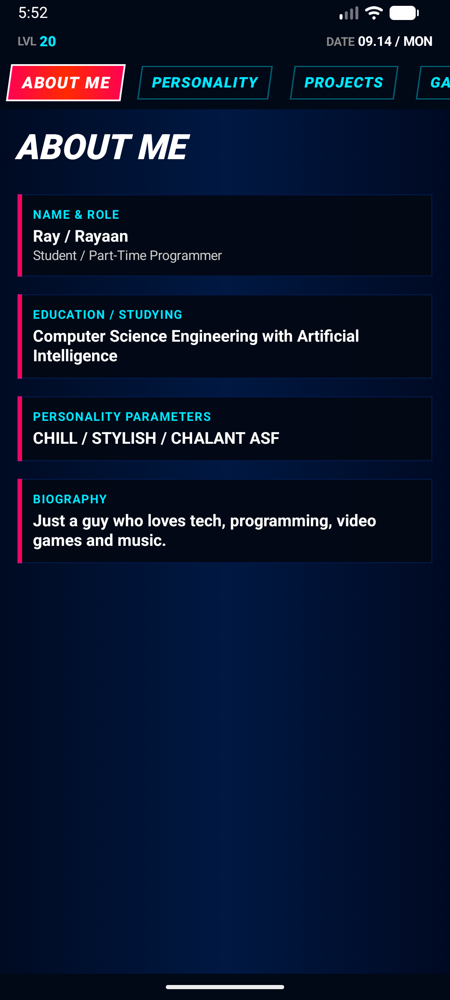
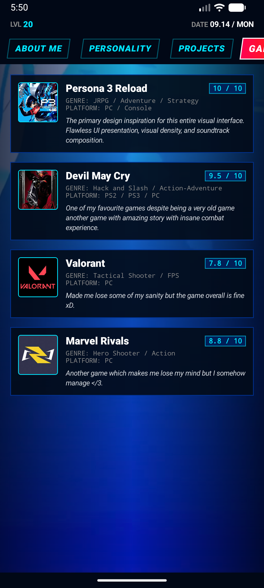
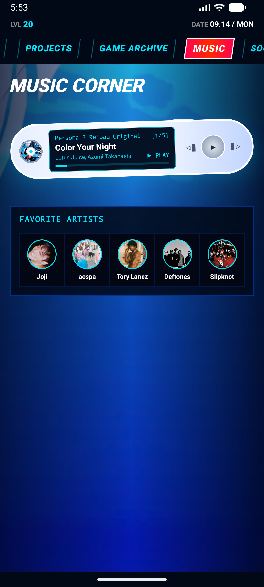

# P3R About Me (Android)

A personal "About Me" profile app styled like the Persona 3 Reload menu: midnight blue, electric cyan, neon red ribbons and slanted HUD text. It is the native Android version of the [P3R About Me website](https://github.com/vexilen-01/persona-3-reload-about-me-website).

Built with Kotlin and Jetpack Compose. Six tabs: About Me, Personality, Projects, Game Archive, Music (a little portable player with 5 P3R tracks) and Social Media. A looping background video plays behind everything.

| About | Games | Music |
|---|---|---|
|  |  |  |

## Run it

You need no phone. On Windows, run this from the repo folder; it sets up an Android emulator if needed, builds the app and opens it:

```powershell
powershell -ExecutionPolicy Bypass -File scripts\run-emulator.ps1
```

The first run downloads a few GB and builds for several minutes. Later runs are fast. Or open the folder in Android Studio and press Run.

The app streams its video, music and images from the website, so it needs internet. Offline it shows placeholders instead of crashing.

## For developers and AI agents

- `AGENTS.md`: rules for contributors and AI tools (git workflow, testing, handoff notes).
- `docs/PROJECT_MAP.md`: one line per source file, plus style rules for new UI.

## Tests

```powershell
.\gradlew.bat testDebugUnitTest
```
